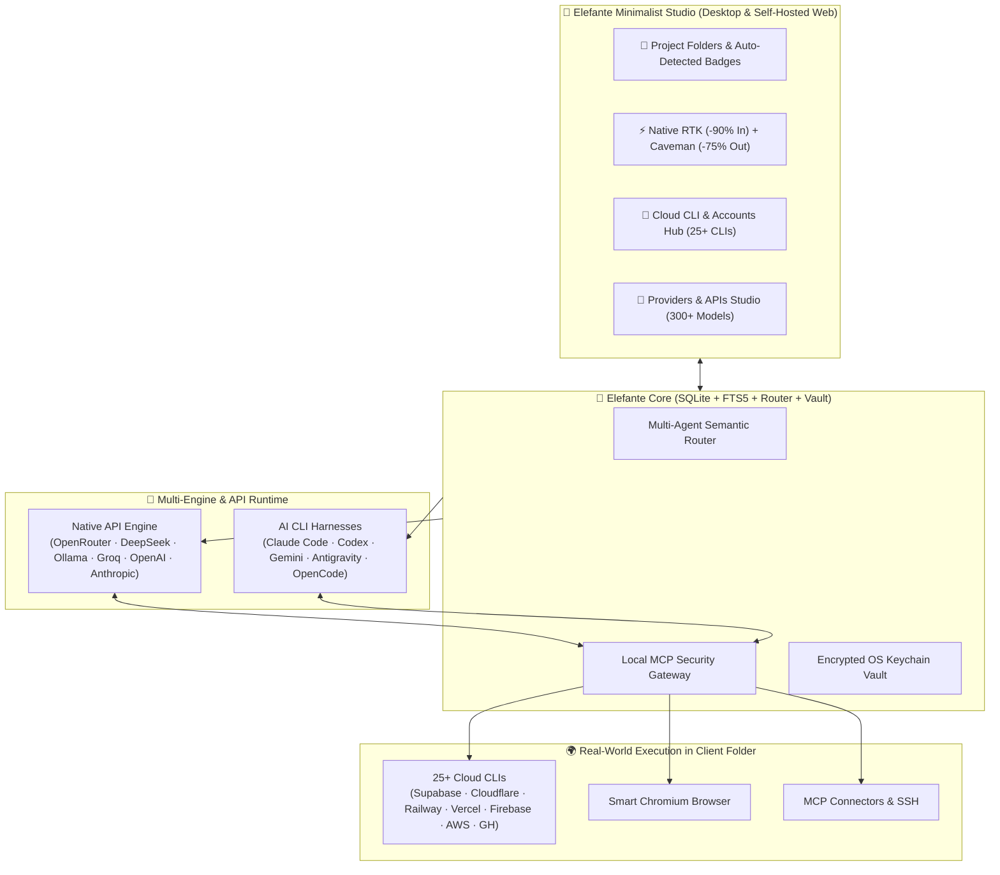

<div align="center">


# 🐘 Elefante

**Folder-First Multi-Agent AI Orchestrator, Cloud CLI Hub, Native RTK & Caveman Studio**  
**Orquestrador Multi-Agente por Projetos, Central de CLIs & Contas, RTK + Caveman Nativos**

[](#-english-overview)
[-10B981?style=for-the-badge)](#-visão-geral-em-português)
[](LICENSE)
[](#)

<br />

### 🛠 Tech Stack & Ecosystem · Tecnologias & Ecossistema

<p align="center">
  <a href="https://skillicons.dev">
    
  </a>
</p>

</div>

---

## 🇺🇸 English Overview

**Elefante** is a native desktop and self-hosted **Folder-First Multi-Agent AI Orchestrator** for Windows, macOS, and Linux. Instead of working with isolated single-turn chatbots or juggling dozens of terminal windows, Elefante binds a **squad of specialized AI agents directly to your real client project directories on disk**.

With Elefante, you are never locked into a single AI vendor: every agent can run on **any API provider** (**OpenRouter 300+ models**, **DeepSeek V3/R1**, **Local Ollama on your GPU**, **Groq LPU**, **OpenAI**, **Anthropic**, **LM Studio**, **vLLM**) or on your existing **CLI harnesses** (**Claude Code**, **Codex**, **OpenCode**, **Pi**, **Gemini CLI**, **Antigravity**) — while sharing built-in **RTK (Rust Token Killer)** + **Caveman Mode** (saving up to **90% tokens**), a unified **Cloud CLI & Connected Accounts Hub (25+ CLIs)**, **Semantic Chromium Browser Harness**, **MCP Security Gateway**, **Persistent SQLite/FTS5 Memory**, and **Autonomous Routines**.

---

### ✨ What Makes Elefante Unique

| Capability | How It Works |
| :--- | :--- |
| 📁 **Project-Folder-First Workflow** | Bind every workspace channel directly to a real project directory on disk (`E:\projects\client-app`). Agents automatically run commands, tests, and file edits inside that folder (`cwd`) and auto-detect project configs (`GitHub`, `Supabase`, `Cloudflare`, `Firebase`, `Vercel`, `Railway`, `Docker`). |
| ⚡ **Built-in RTK + Caveman Mode (-90% Tokens)** | Native **RTK (Rust Token Killer)** proxy automatically compresses noisy outputs from `git`, `npm`, `pnpm`, `cargo`, `vitest`, `tsc`, `ls`, `grep`, and `docker` by **60–90% input tokens**. **Caveman Mode (`LITE` / `FULL` / `ULTRA`)** strips fluff and reduces output tokens by up to **75%** while keeping 100% technical precision. |
| 🔑 **Cloud CLI & Connected Accounts Hub (25+ CLIs)** | Instantly inspect which infrastructure CLIs are installed and which account/email is logged in on your machine: **GitHub (`gh`)**, **Supabase**, **Cloudflare (`cf`/`wrangler`)**, **Railway**, **Vercel**, **Firebase**, **AWS**, **Google Cloud (`gcloud`)**, **Azure (`az`)**, **Netlify**, **Fly.io**, **Neon**, **Turso**, **PlanetScale**, **Stripe**, **Docker**, **Kubernetes (`kubectl`)**, **Terraform**, **ngrok**, **Tailscale**, **npm**, **Ollama**, **Hugging Face**, and **RTK** — plus 1-click terminal login/switch. |
| 🧠 **Native Providers & APIs Studio (300+ Models)** | Connect **OpenRouter**, **DeepSeek API**, **Local Ollama (GPU)**, **Groq Cloud**, **OpenAI**, **Anthropic**, or any `/v1/chat/completions` endpoint directly in the UI. Mix and match different models in the same project. |
| 🌐 **Smart Chromium Browser Harness** | Built-in real Chromium engine with persistent logins and cookies. Extracts a compact semantic accessibility tree (`[12] button "Publish"`) instead of raw HTML, cutting token usage by **90%+** and enabling any model to navigate, click, fill forms, and inspect live web apps. |
| 🔌 **Unified MCP Gateway & Telegram Approvals** | Connect **Supabase**, **Hostinger**, **Cloudflare**, **Firebase**, **GitHub**, **Postgres**, or any Stdio/HTTP MCP server. Every tool is classified into `Read`, `Write`, or `High-Risk` with human-in-the-loop approval cards (in-app or on your phone via **Telegram Bot**). |
| ⏰ **3-Tier Memory & Autonomous Routines** | Automatic rolling conversation summaries + long-term factual memory + `SKILL.md` playbooks + cron routines and GitHub PR/webhook triggers. |

---

### 🏛 System Architecture



---

### 🚀 Quick Start (English)

```bash
# 1. Clone the repository
git clone https://github.com/vncsrmro/elefante.git
cd elefante

# 2. Install dependencies
npm install

# 3. Start in development mode
npm run dev

# 4. Run typecheck and test suite (36 test files, 328 tests)
npm run typecheck && npm test

# 5. Package desktop installer (Windows / macOS / Linux)
npm run dist
```

---

<br />

## 🇧🇷 Visão Geral em Português

O **Elefante** é um estúdio de orquestração multi-agente nativo para desktop (**Windows, macOS e Linux**) desenhado para quem trabalha com **múltiplos projetos e clientes reais**. Em vez de usar chats genéricos soltos ou dezenas de janelas de terminal, cada projeto na barra lateral do Elefante é vinculado diretamente à **pasta real do cliente no seu disco** (`cwd`).

---

### 🔥 Diferenciais Exclusivos do Elefante

1. **📁 Fluxo Direto por Pasta de Projeto (Estilo Orca / Linear)**:
   - Vincule qualquer pasta local do seu computador em 1 clique. Os agentes executam comandos, leem código, rodam testes e sobem servidores diretamente dentro daquela pasta.
   - O topo de cada projeto detecta automaticamente os arquivos de infraestrutura presentes na pasta (`● GitHub`, `● Supabase`, `● Cloudflare`, `● Firebase`, `● Vercel`, `● Netlify`, `● Railway`, `● Fly.io`, `● Docker`) e exibe badges clicáveis em tempo real.
2. **⚡ RTK (Rust Token Killer) + Modo Caveman Nativos (-90% de Tokens)**:
   - **RTK Nativo (`RTK ON`)**: Intercepta automaticamente comandos de terminal (`git`, `npm`, `pnpm`, `yarn`, `cargo`, `vitest`, `jest`, `tsc`, `ls`, `grep`, `rg`, `docker`, `kubectl`, `pytest`, `gh`) e condensa a saída mantendo 100% do sinal técnico, reduzindo de **60% a 90% dos tokens de entrada**.
   - **Modo Caveman (`LITE` / `FULL` / `ULTRA`)**: Botão rápido no topo da conversa que elimina enrolação nas respostas dos agentes e economiza até **75% dos tokens de saída**.
3. **🔑 Central de CLIs & Contas Conectadas (25+ Ferramentas Cloud & DevOps)**:
   - Painel unificado que detecta instantaneamente quais CLIs estão instaladas no seu PC, qual versão está no `PATH` e **qual conta/e-mail está logada** em cada uma:
     - **Cloud & Deploy**: `Cloudflare (cf / Wrangler)`, `Railway`, `Vercel`, `Firebase`, `AWS CLI`, `Google Cloud (gcloud)`, `Azure (az)`, `Netlify`, `Fly.io (flyctl)`
     - **Bancos de Dados**: `Supabase CLI`, `Neon Serverless Postgres`, `Turso (libSQL)`, `PlanetScale (pscale)`
     - **Código, Containers & DevOps**: `GitHub CLI (gh)`, `Stripe CLI`, `Docker`, `Kubernetes (kubectl)`, `Terraform`, `ngrok`, `Tailscale`, `npm Registry`
     - **IA Local & Otimização**: `Ollama Local GPU`, `Hugging Face CLI`, `RTK (Rust Token Killer)`, além dos motores `Claude Code`, `OpenAI Codex`, `Gemini CLI`, `Antigravity (agy)` e `OpenCode`.
   - Permite **Fazer Login**, **Trocar de Conta** ou **Instalar a CLI** em 1 clique abrindo o terminal autenticado.
4. **🧠 Hub Nativo de Provedores & APIs (300+ Modelos)**:
   - Conecte **OpenRouter**, **DeepSeek API (V3 & R1)**, **Ollama Local (100% gratuito na GPU)**, **Groq Cloud (LPU)**, **OpenAI**, **Anthropic** ou qualquer gateway compatível com `/v1/chat/completions` com chaves protegidas no cofre criptografado do sistema operacional.
5. **🌐 Browser Harness Semântico, Conectores MCP, Memória SQLite/FTS5 & Telegram**:
   - Navegador Chromium integrado com extração de árvore semântica (`-90% tokens`) e botão **"Assumir o navegador"** para resolver logins/2FA.
   - Gateway MCP com aprovação de ferramentas críticas direto no app ou pelo celular via **Bot do Telegram**.

---

### 🛠️ Como Rodar ou Compilar do Código-Fonte

```bash
# 1. Clone o repositório
git clone https://github.com/vncsrmro/elefante.git
cd elefante

# 2. Instale as dependências
npm install

# 3. Inicie em modo de desenvolvimento
npm run dev

# 4. Rode a verificação de tipos e suíte de testes (36 arquivos, 328 testes)
npm run typecheck && npm test

# 5. Gere o instalador nativo (Windows / macOS / Linux)
npm run dist
```

---

<div align="center">

### 👨‍💻 Author · Autor

Created by **Vinicius Romeiro** ([@vncsrmro](https://github.com/vncsrmro)) · `vinicius@romei.ro`

<p align="center">
  <a href="https://skillicons.dev">
    
  </a>
</p>

</div>
